# Actions sprint report (31 Oct 2026)

Focus: ACTIONS only. Every promise and every button leads to something happening. Out-of-focus problems seen along the way are in docs/backlog.md, not fixed.

All screenshots are at 412x915, NORMAL speed, played by taps (tests/e2e/actions.spec.js). The same checks run at ?fast=1 with `FAST=1`.

## Finish line

| | Check | Result |
|---|---|---|
| A1 | "Walk away" ends the chat and the player moves off | Done. The card closes, they wave, you turn and walk about 4 m away (the test checks you moved more than 2 m). |
| A2 | Student -> "Let's get something to eat" -> both walk to the caf, queue, buy, sit together and eat | Done. They walk your path a step behind you, queue right behind you, Auntie Pinky's menu opens at the front, you pay (R30 for pap and wors), then you both sit at the same terrace table with a plate each and chat while you eat. |
| A3 | Student -> "Let's study" -> both go to the library and study | Done. You walk to the library together, go in, sit at the desks and quiz each other (+3 Grades, +2 Social). |
| A4 | "Swap numbers" -> the contact appears in your phone | Done. The card says they're in your phone and has a "See your phone" button that opens your student card's phone with their name. |
| A5 | Tap Auntie Pinky -> back of the line -> front -> order -> pay -> sit and eat | Done. "Back of the line, baby!", the line moves up as each person is served, her menu opens at the front, pay, sit at a table, eat, stand. Mam' Gugu works the same way at the Quad (test A5b). |
| A6 | The full list of conversation replies and what each does | [replies.md](replies.md): all 234 people and student replies, the 20 replies with the student from the bus stop, and every morning and lecture choice. |
| A7 | UX audit: zero dead ends | Done: 0 dead ends across 17 screens and 295 tap targets ([ux-audit.md](ux-audit.md)). |

### A1: Walk away
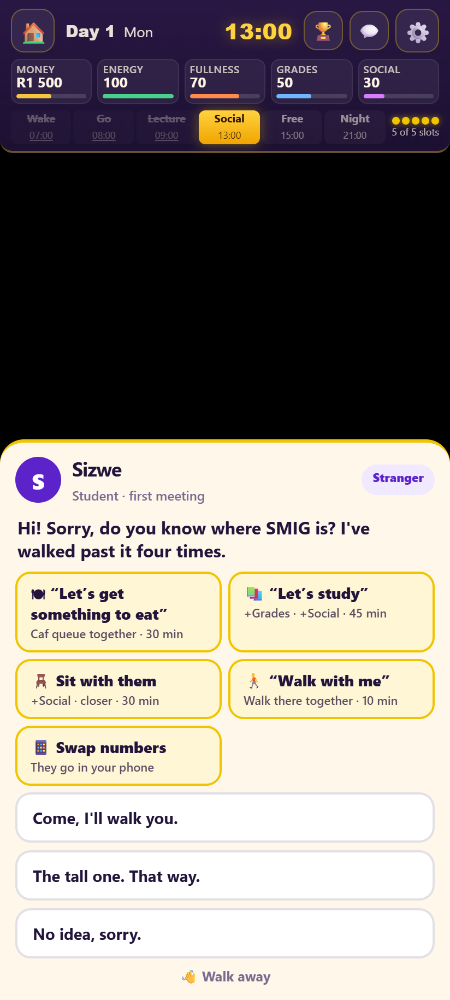 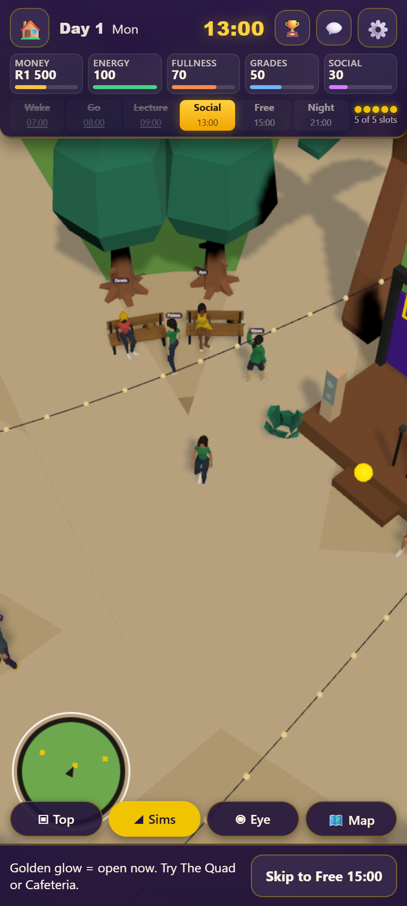 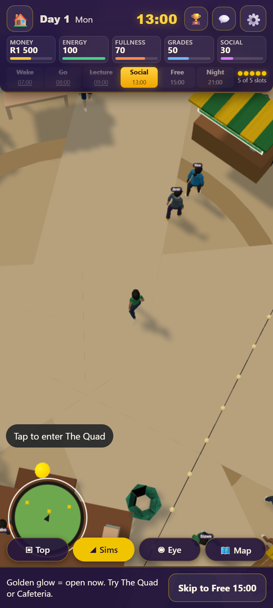

### A2: Let's get something to eat
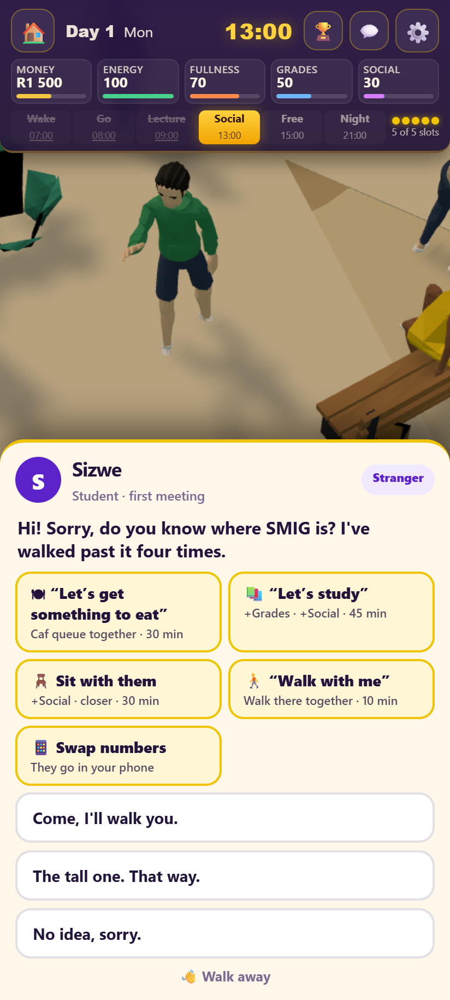 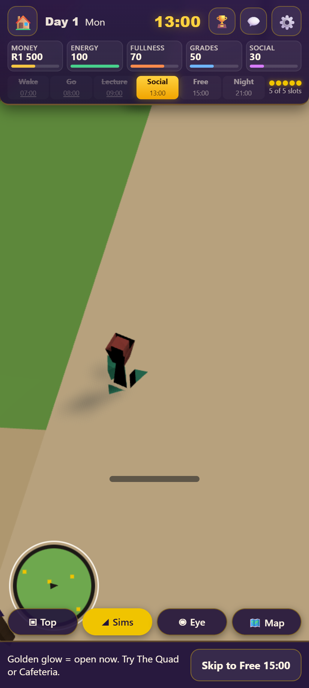 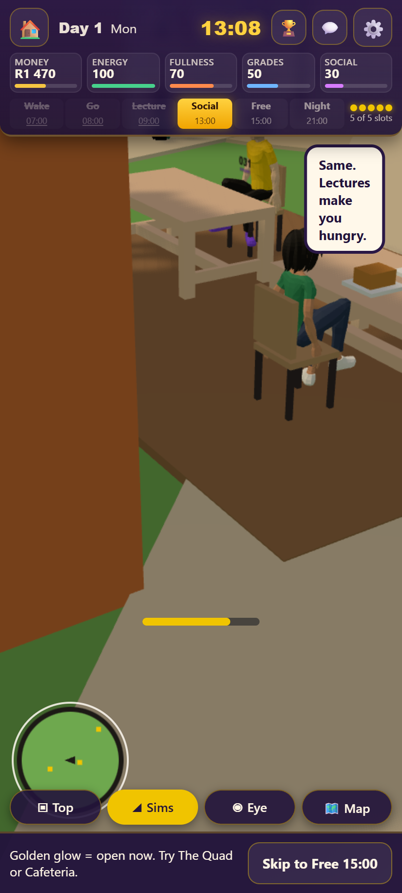 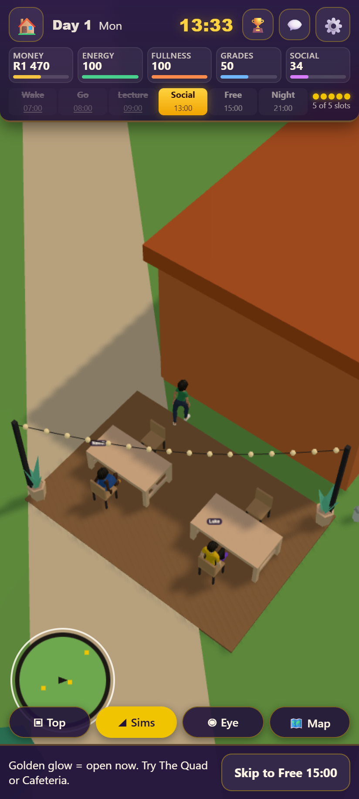

### A3: Let's study
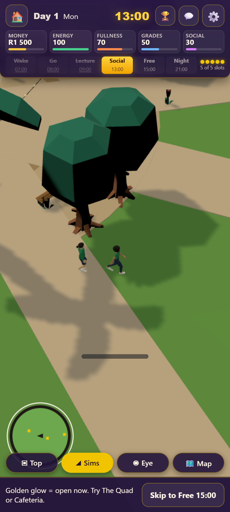 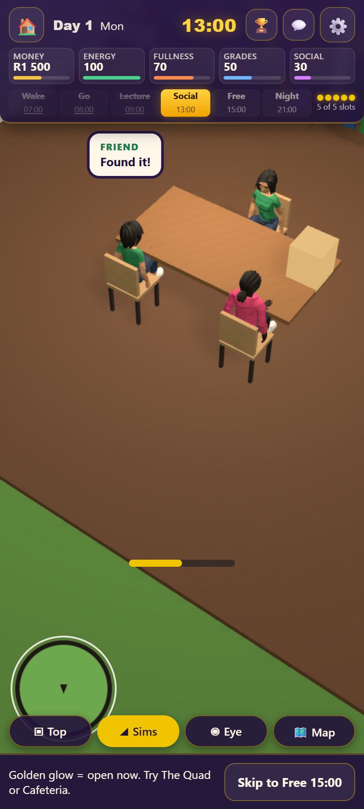 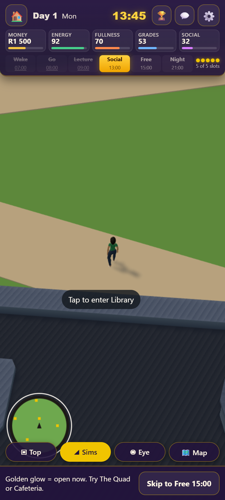

### A4: Swap numbers
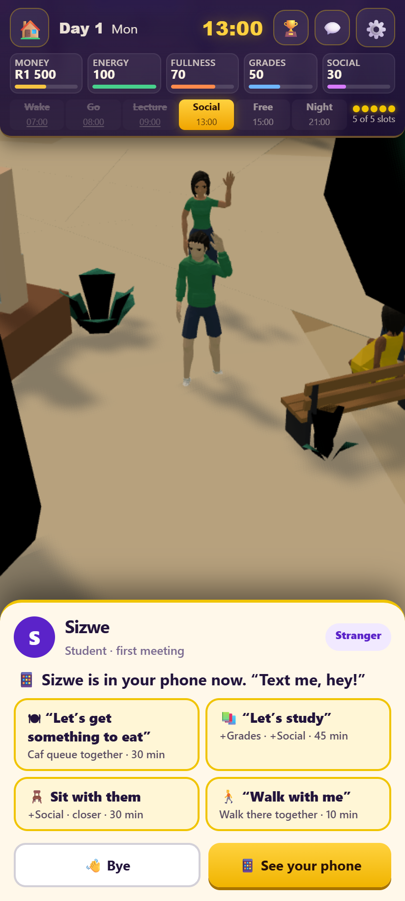 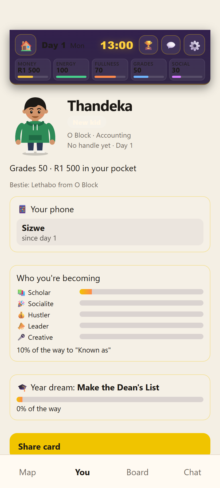

### A5: Auntie Pinky's queue
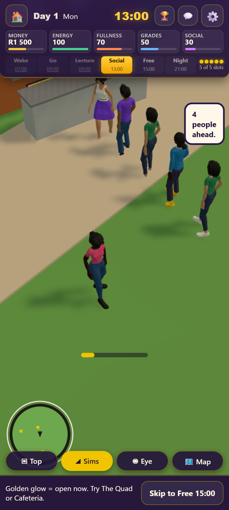 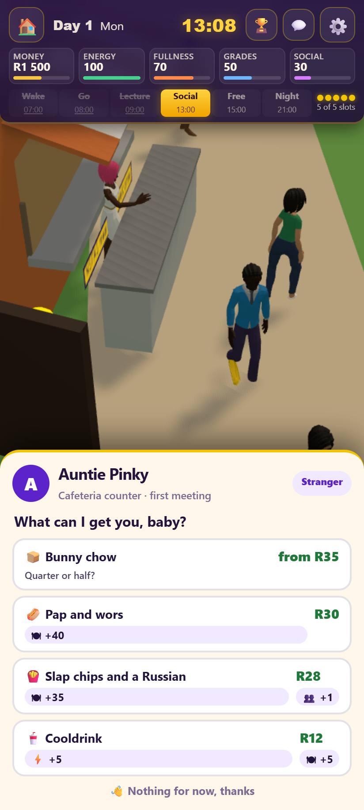 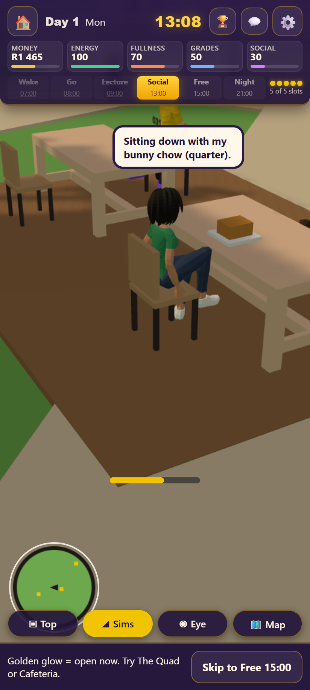 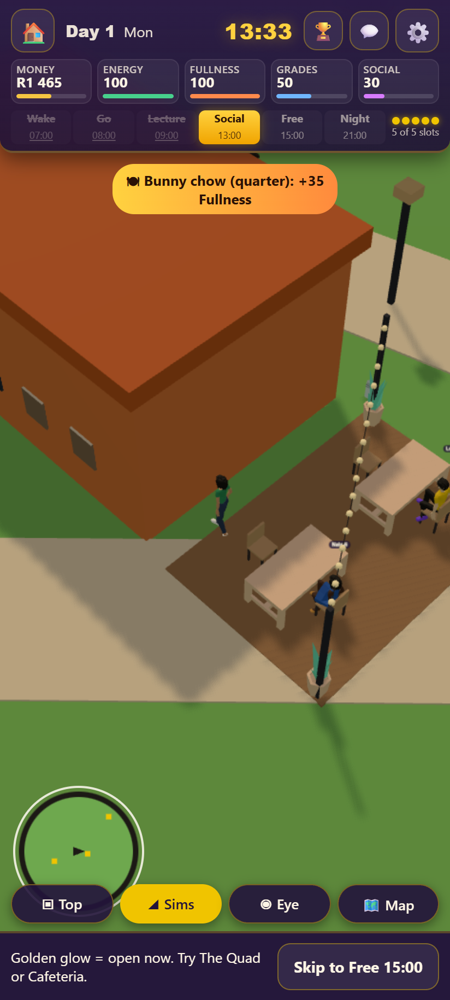

## What changed

- **Every reply has an act** (people.json `act`, crush-arc.js): bye, eat, study, sit, walk, swap, order, consult, or none (their answer and what it changed, then what you can do together). An action reply starts the action straight away, with their answer as the first line of the scene. A goodbye reply shows their answer and one "Bye" that walks you off. Totals: 67 bye, 9 eat, 6 study, 10 sit, 5 walk, 6 swap, 6 order, 10 consult, 135 answer-then-choose.
- **The talk card's buttons for students**: "Let's get something to eat", "Let's study", "Sit with them", "Walk with me", "Swap numbers" (each disappears once done today, swap once they're in your phone).
- **Someone coming along** (src/world/scene.js, `startCompanion`): the real person leaves what they were doing and walks your path a step behind you, through the queue, to the table or the library door. Inside a room the scene's copy of them sits with you; outside they're back beside you. When it's over they carry on with their day.
- **Walk with me** (new scene `walkTogether`): you walk together to your lecture venue if it's next, otherwise to the Quad (or the library if you're at the Quad), chatting on the way.
- **Bye always walks you off**: "Walk away", "Bye" and goodbye replies end the chat with a wave and a few steps away, so the end of a chat is visible.
- **Lines say who's talking**: in the library, your friend's lines carry their name instead of "Friend".

## UX audit (A7)

**0 dead ends** across 17 screens and 295 tap targets (full run, 15.6 min). Every button was tapped one at a time from a fresh state, and any tap that changed nothing visible would have counted as a dead end. Three talk screens are new this sprint: after a reply (17 targets), a goodbye reply (11) and numbers swapped (16). The audit now also counts "walking away" and "someone came with you" as visible changes. Full table: [ux-audit.md](ux-audit.md).

| Screen | Targets | Dead ends |
|---|---|---|
| Cover | 6 | 0 |
| Creator: look | 24 | 0 |
| Creator: story | 28 | 0 |
| Campus (3D) | 15 | 0 |
| Campus map (2D) | 30 | 0 |
| Menu (gear) | 27 | 0 |
| Place sheet: Cafeteria | 16 | 0 |
| Talk: a student | 19 | 0 |
| Talk: Mam' Gugu | 15 | 0 |
| Talk: after a reply | 17 | 0 |
| Talk: a goodbye reply | 11 | 0 |
| Talk: numbers swapped | 16 | 0 |
| Goals card | 17 | 0 |
| You (student card) | 16 | 0 |
| Leaderboards | 17 | 0 |
| Campus lobby (chat) | 11 | 0 |
| Milestones | 10 | 0 |

## Still open (for later sprints, in docs/backlog.md)

- A blocky stand-in figure shows on the walk to the caf queue while a model loads (A2-2).
- The student card screen has the HUD floating over its top (A4-2).
- With five action buttons the talk card covers most of a phone screen.
- A friend walking with you trails a step behind on your path; side by side would read better.
- The eat-together camera at the terrace crops the friend at the top (A2-3).
- When the activity ends, a student you walked off with snaps back to their old spot instead of walking back.

## Tests run

- tests/e2e/actions.spec.js: A1-A5 at normal speed (screenshots), all 7 tests at ?fast=1. Passing.
- tests/e2e/talk-people.spec.js (21 tests) and tests/e2e/scenes.spec.js. Passing. The "they remember you" test now picks replies that keep the chat going, since its first reply now starts doing something together.
- tests/e2e/ux-audit.spec.js: full run, three new talk screens added (after a reply, a goodbye reply, numbers swapped).
- npm run check: 46 checks passed.
