# Motion sprint report (31 Oct 2026)

Focus: MOTION only. Every body moves, stands, sits and lies like a real person, the player and every NPC, in every scene. Problems outside the focus went to docs/backlog.md and were not fixed.

Everything here is at 412x915 and NORMAL speed, played by taps and the stick (tests/e2e/motion.spec.js, one worker). Each journey has a video (`.webm`, open it in a browser) next to its screenshots, because still screenshots can't show sliding feet.

## What was wrong, and the fix

| | Problem found | Fix |
|---|---|---|
| Feet | The animations bend the legs but never move the feet (they are IK bones the clips only turn), so shoes stretched back to where they started ("melting" feet). The walk also dipped the feet up to 18 cm into the ground. | Each foot now rides at the end of its shin every frame. A few sole points per shoe are read every frame, and the body stands on the lowest one, so feet rest on the ground through every clip and blend. |
| Sliding | Walkers moved at 2-3 m/s and you at 6.2 m/s while the walk animation was made for about 1.1 m/s. | Each clip's natural stride speed is measured once per outfit, and the walk/run plays at the speed the person really moves. Realistic speeds: crowd 1-1.5 m/s, you a brisk 2 m/s, long trips a jog (up to 9 m/s, so no walk takes over 12 s). Walking in place against a wall now stands still. |
| Turns | Bodies snapped to face each new direction. | The body turns smoothly towards where it's going. |
| Shoes | Sandals, flip-flops and pumps showed bare skin on the feet. | Every foot shows a shoe; white soles stay white. |
| Sitting | Hips hovered 4-6 cm above seats or sank into them, people perched on the front edge, feet dangled 15-22 cm off the floor at the caf, and the stage sitter floated beside the step. | Once per person and seat, the body is measured: the back slides to the backrest, the seat of the trousers lands on the seat, and the thighs and shins angle so the soles rest flat on the floor (high caf chairs slope the thighs, the low stage step reaches the shins forward). The stage sitter sits on the step. |
| Lying | Bodies lay inside or above the mattress, a bed turned sideways rolled you onto your side, and getting in and out snapped between poses. | You lie on your back on top of the mattress, head on the pillow. Into bed: sit on the edge, swing the legs up and lie back. Out of bed: sit up on the edge, then stand. |
| Collisions | Indoors, scene walks went straight through beds, desks and tables, and people popped onto seats. Outdoors, the 1 m route grid stopped you 2-3 m short of walls, like an invisible wall. | Rooms record their furniture and walks route around it; people walk up to their seat. The stick walks you right up to the real outline of buildings, tables and stalls (0.3 m away) and slides along them, never through. |
| Friend | A friend walking with you trailed a step behind, got stuck behind counters, appeared on their chair, and jumped back to their spot afterwards. | They walk level with you, a shoulder's width to the side (behind you only in narrow places), take the route round anything in the way, walk to their chair and sit, and walk back to their spot afterwards. The meal waits until they're seated. |
| Stand-in | A blocky capsule showed while a model loaded. | Nobody shows until their model is ready; then they fade in. |

## Finish line

All 13 checks pass (`npx playwright test tests/e2e/motion.spec.js --config playwright.edge.config.js --workers=1`, 13.5 min).

| | Check | Result | Video |
|---|---|---|---|
| M1 | Walk across the Quad for 20 s: feet don't slide or sink, turns smooth | Pass. Soles stay between -0.6 cm and 0 cm of the ground the whole walk; the walk plays at the real ground speed in every sample (0 sliding samples, e.g. moving 1.28 m/s with the clip at 1.27 m/s); the fastest turn is 2.5 rad/s, no snapping. | [M1-quad-walk.webm](M1-quad-walk.webm) |
| M2 | Sit on a Quad bench, a caf chair, a lecture bench, a library chair | Pass. You: seat of the trousers 0.4 cm (bench), 1.5 cm (caf chair), 0.9 cm (library), 0.5 cm (lecture bench) from the seat; feet within 2.5 cm of the floor. Every seated NPC on campus and in the lecture hall is checked the same way (0-1 cm). | [quad bench](M2-quad-bench.webm), [caf chair](M2-caf-chair.webm), [library](M2-library-chair.webm), [lecture](M2-lecture-bench.webm) |
| M3 | Go to bed, sleep, get up next morning | Pass. In res: sit on the bed edge (hips on the mattress, feet on the floor), swing in and lie back: body exactly on top of the mattress (0 cm), head on the pillow; next morning sit up on the edge, then stand. The day-1 morning bed is the same. | [res](M3-bed.webm), [day-1 morning](M3b-morning.webm) |
| M4 | Walk into a wall, a bed and a table | Pass. Wall: you walk up to SMIG and stop 0.31 m from it (your half-width). Table: you stop 0.33 m from it. Bed: in res you walk round the other bed, desk and chair to your bed (never within 0.25 m of furniture until the last step onto the edge). Nothing is ever entered. | [wall](M4-wall.webm), [table](M4-table.webm), [bed](M4-bed.webm) |
| M5 | Eat together: friend walks beside you, sits properly, walks back | Pass. Level with you, a shoulder's width to the side, in about 70% of walking samples (the rest is them catching up from where you talked, and narrow spots); in the queue they stand behind you; at the terrace they walk to the other chair and sit (hips 1.9 cm from the seat) and the meal starts once they're seated; afterwards they walk back towards the Quad (10 m in the first 18 s, no step over 0.5 m: no jump). | [M5-eat-together.webm](M5-eat-together.webm) |
| M6 | Every outfit, player and NPC: shoes on | Pass. All 14 outfit looks (6 men's, 8 women's) lined up, plus all 39 people in the world: no skin on any foot, every standing sole on the ground. | [M6.webm](M6.webm) |
| M7 | A crowded Quad for 30 s: nobody frozen, nobody through anyone | Pass. 35 people sampled every 0.4 s for 30 s: nobody frozen, nobody sliding while idle, nobody closer than 0.45 m to anyone. One walker took a single walking frame on the spot while starting a turn (x4, one sample). | [M7-crowded-quad.webm](M7-crowded-quad.webm) |

### M1: walking across the Quad
   

### M2: sitting
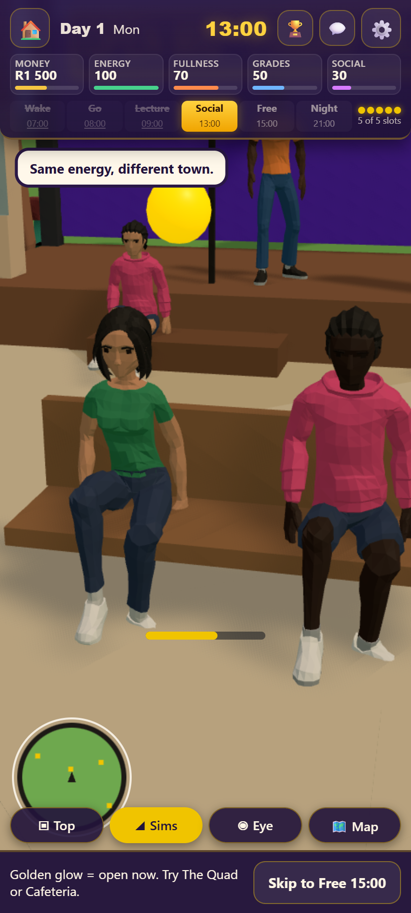 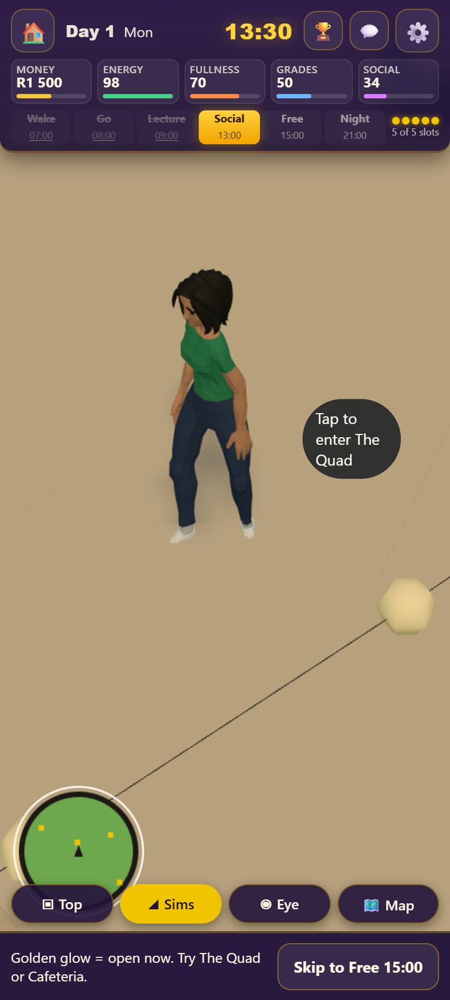 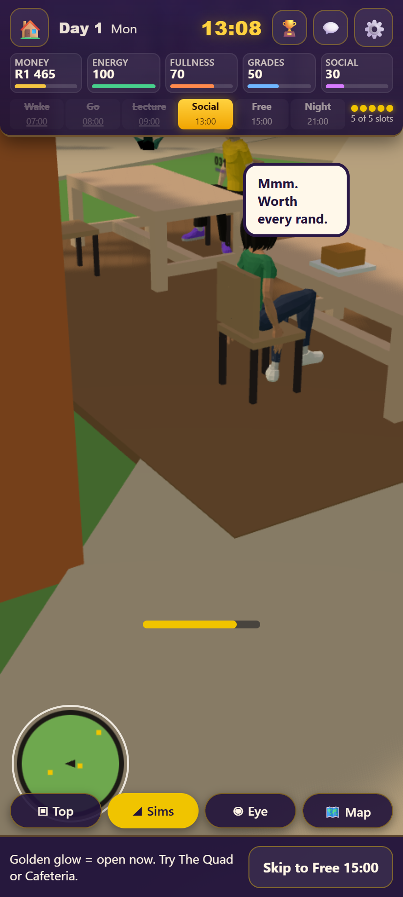 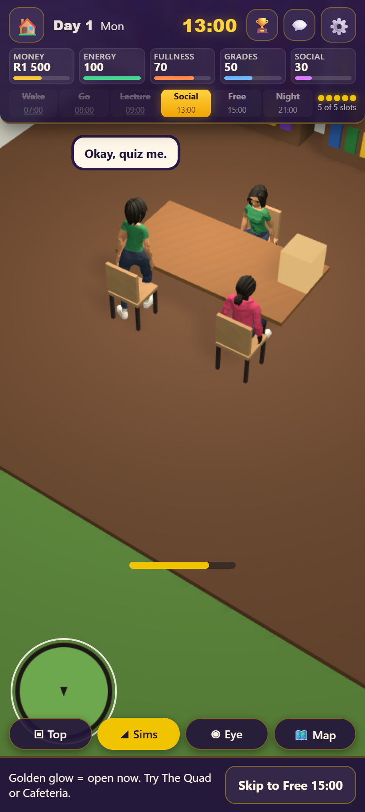 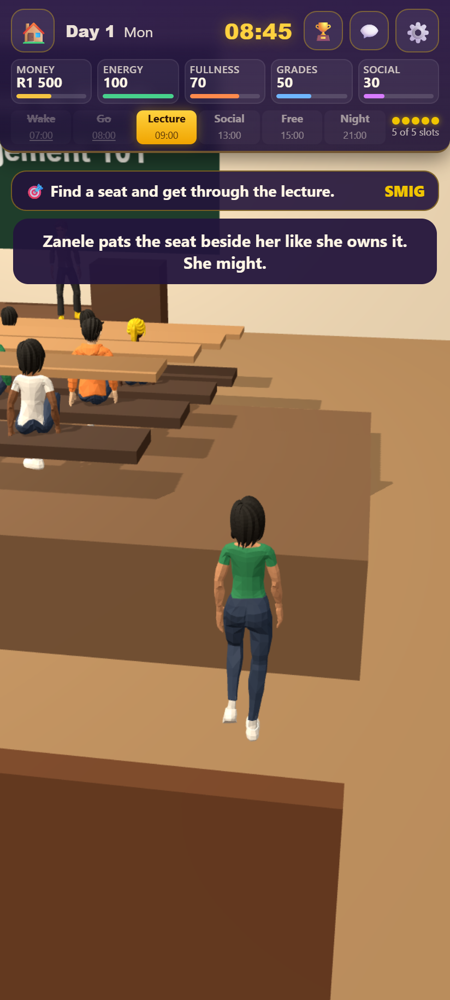

### M3: bed
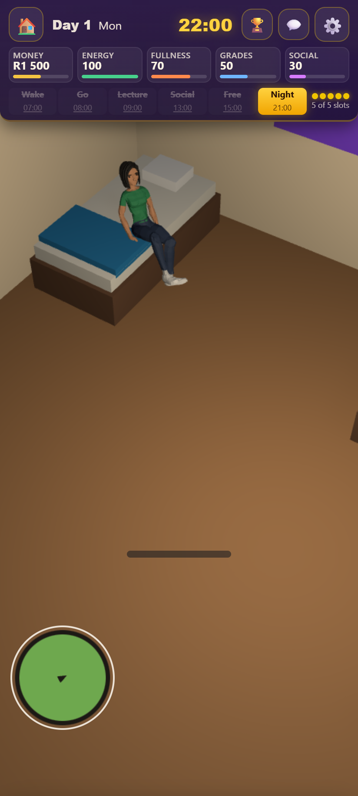 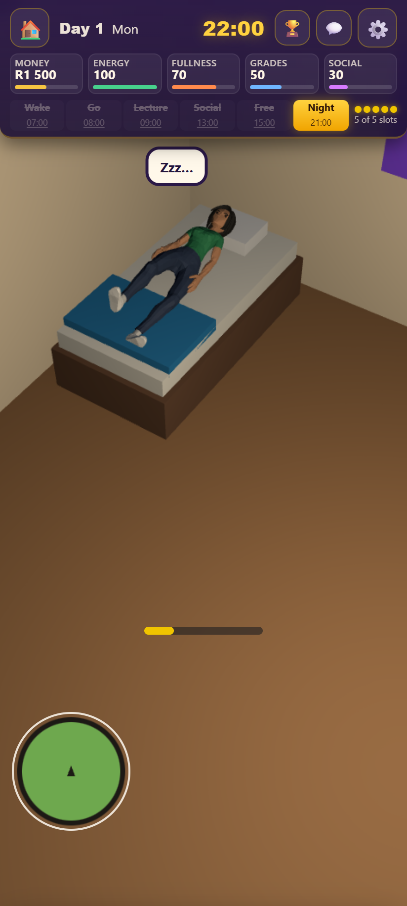 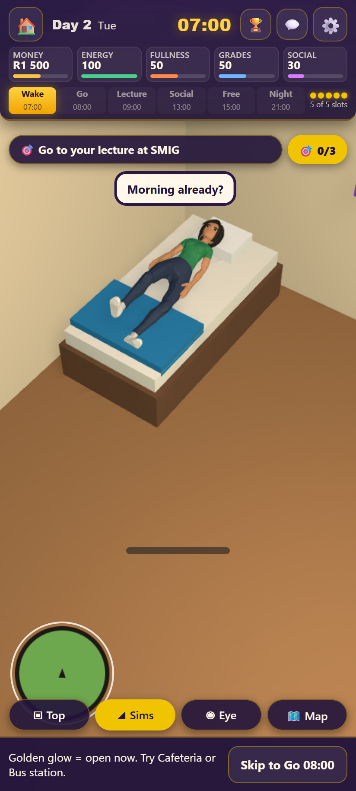 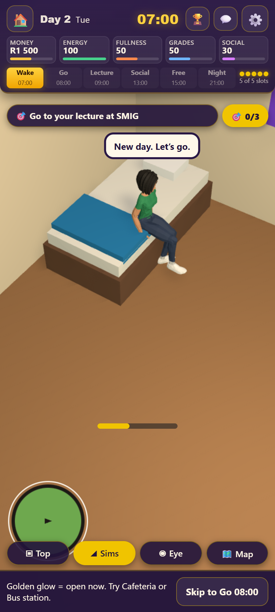 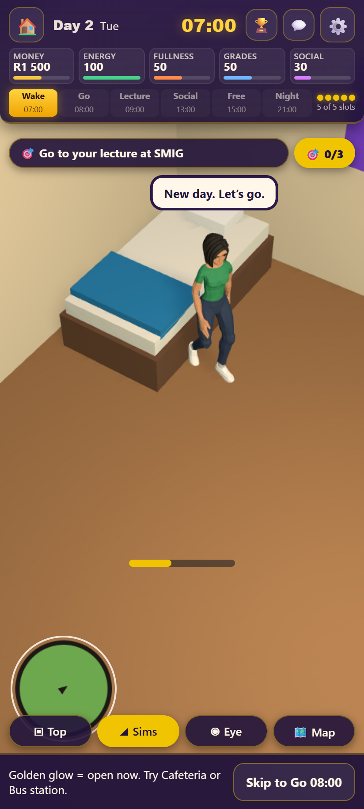 
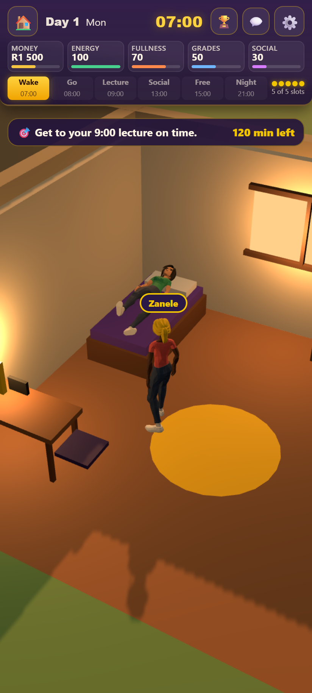 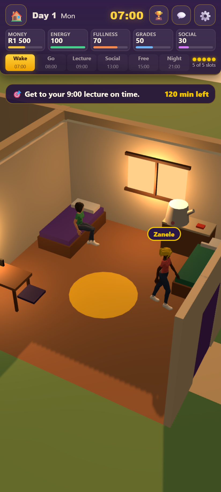 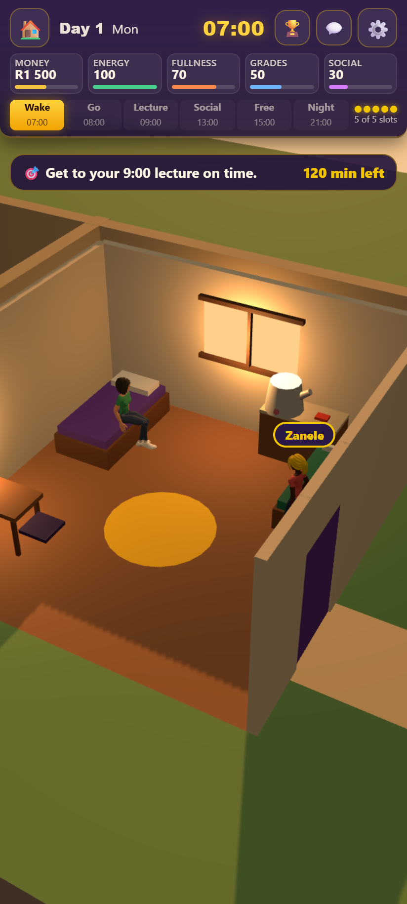

### M4: wall, table, bed
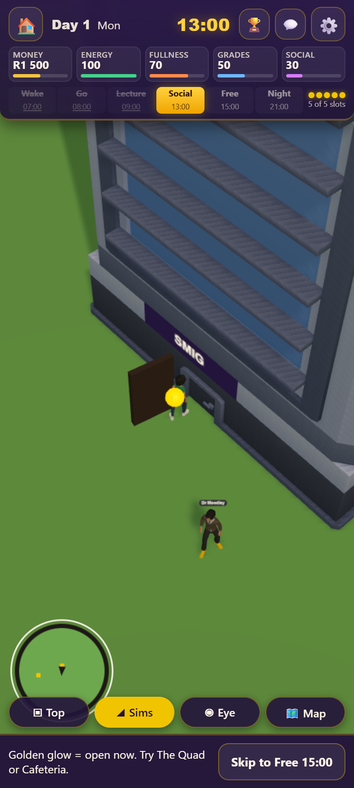 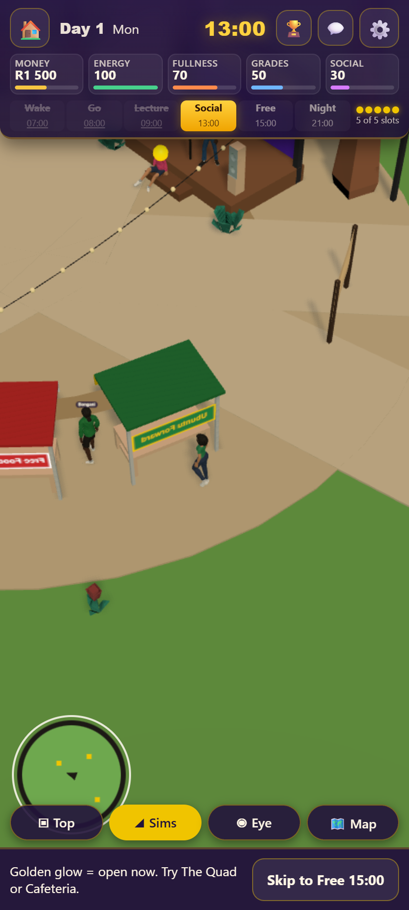 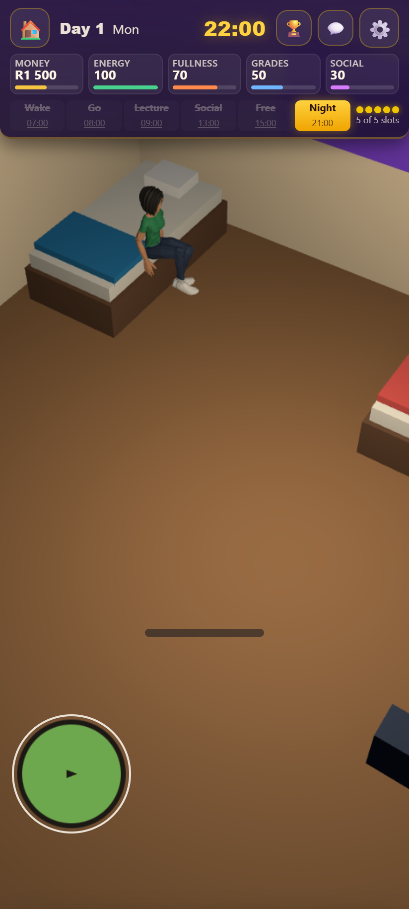

### M5: eating together
  
(The walking shot catches the camera inside a tree canopy; the video shows the walk. Camera problem logged in the backlog.)

### M6: shoes
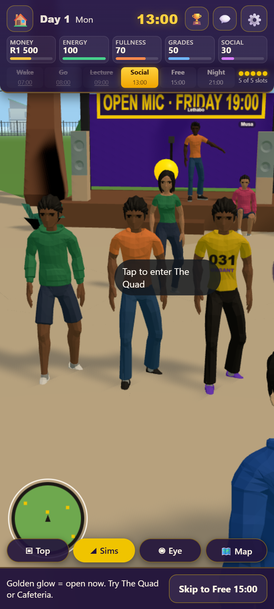 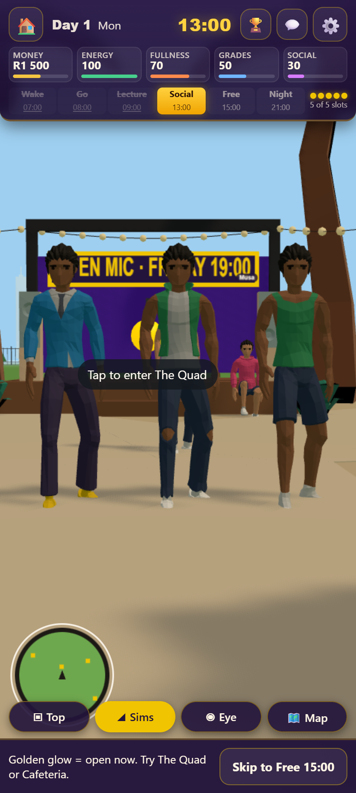 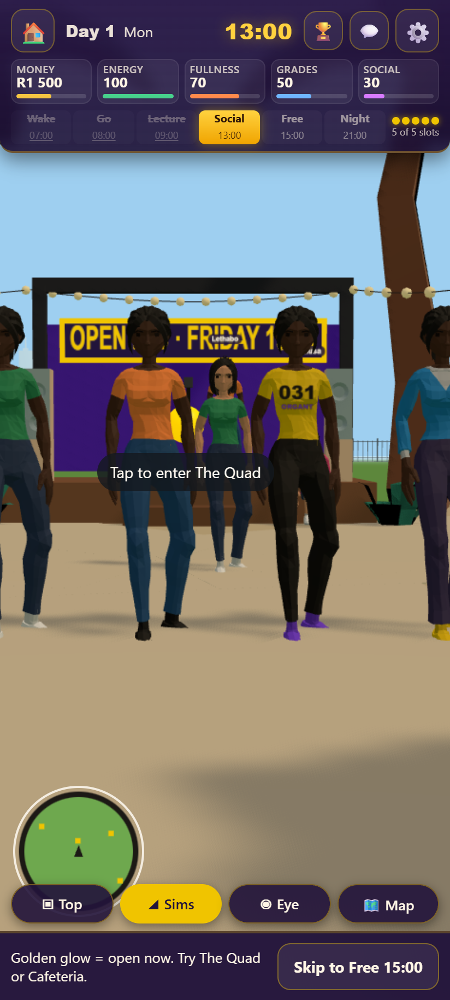 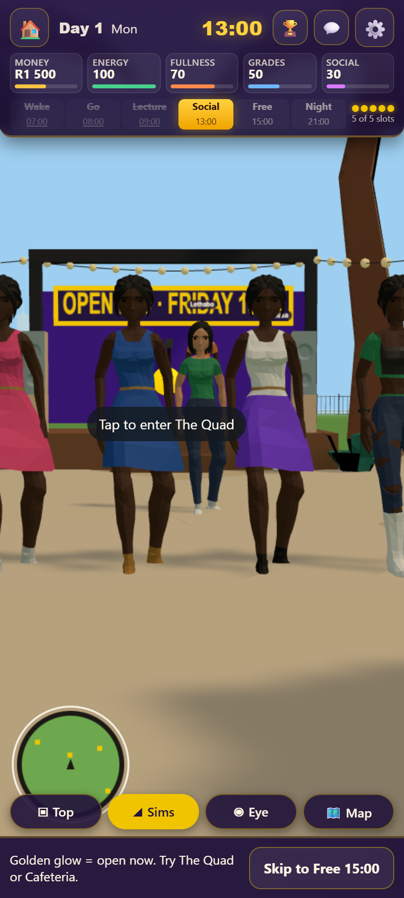

### M7: crowded Quad
  

## Automatic checks (window.mzansiBodies)

Every rigged person in a live scene is measured from their skinned vertices: the lowest sole point, the seat of the trousers (the lowest point right under the hips), the lowest point overall, and the animation clip, rate and clock. The tests turn those into:

- feet: soles within 3 cm of the ground while standing and walking (M1, M6);
- sliding: walk/run rate x the clip's natural speed matches the real ground speed (M1);
- turns: how fast the body's facing changes, sampled every 50 ms (M1);
- sitting: seat of the trousers within 3 cm of the seat, soles within 5 cm of the floor under it (M2, M3, M5);
- lying: lowest point of the body within 3 cm of the mattress top (M3);
- collisions: the player never inside a building, table or piece of room furniture (M4); nobody standing or walking closer than 0.45 m to anyone else (M7);
- nobody frozen: everyone's animation clock keeps running; nobody slides along while idle; nobody walks on the spot (M7);
- shoes: no skin material on any foot, for every outfit and every NPC (M6).

## Still open

- On the longest map trips (a jog near 9 m/s, only for walks over about 75 m), female characters' feet slide a little: their run clip's stride tops out lower than the men's. A shorter cap would break the 12-second walk rule; Skip there is the alternative for those trips.
- Seated arms keep the standing idle, so hands hang beside the seat rather than resting on the lap or table.
- The motion checks need one test worker: with more, the headless browser renders too few frames for walkers to move, and the timing checks misfire.
- Full test suite at the end of the sprint: see the commit notes for its result.
- Out of focus, logged in docs/backlog.md: dresses and skirts spike at the thighs when sitting; the walking camera can end up inside a tree canopy.
